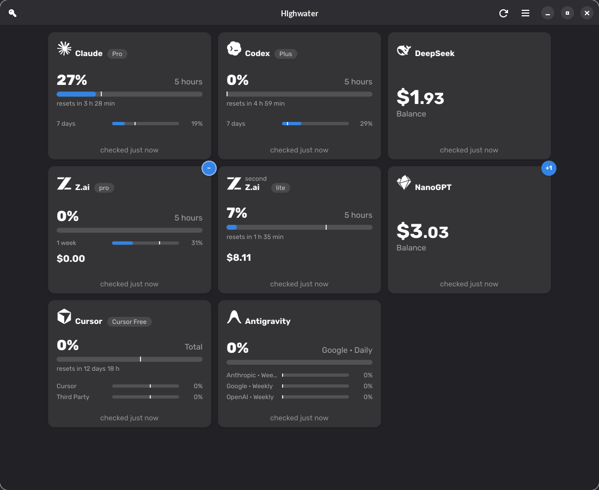
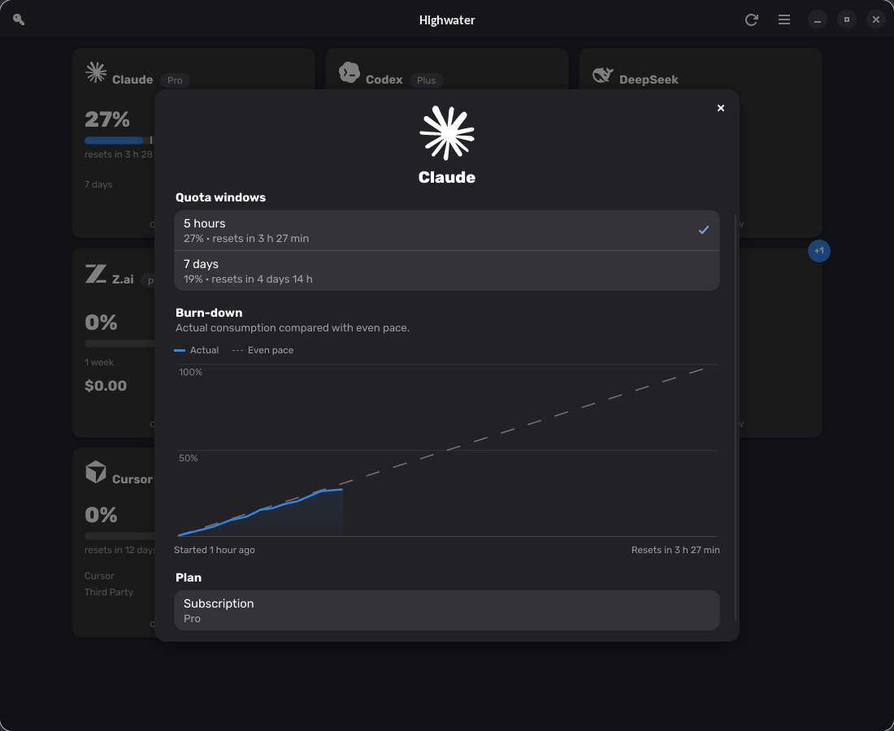
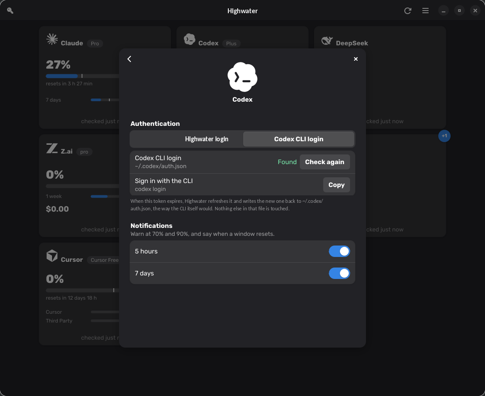
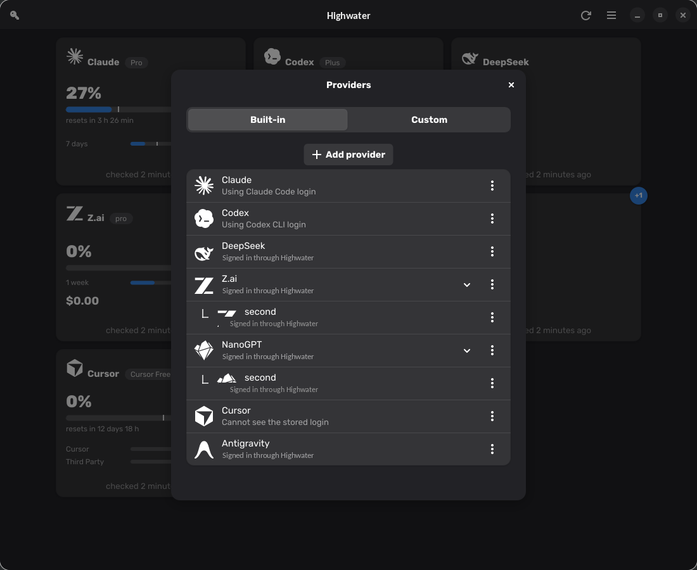
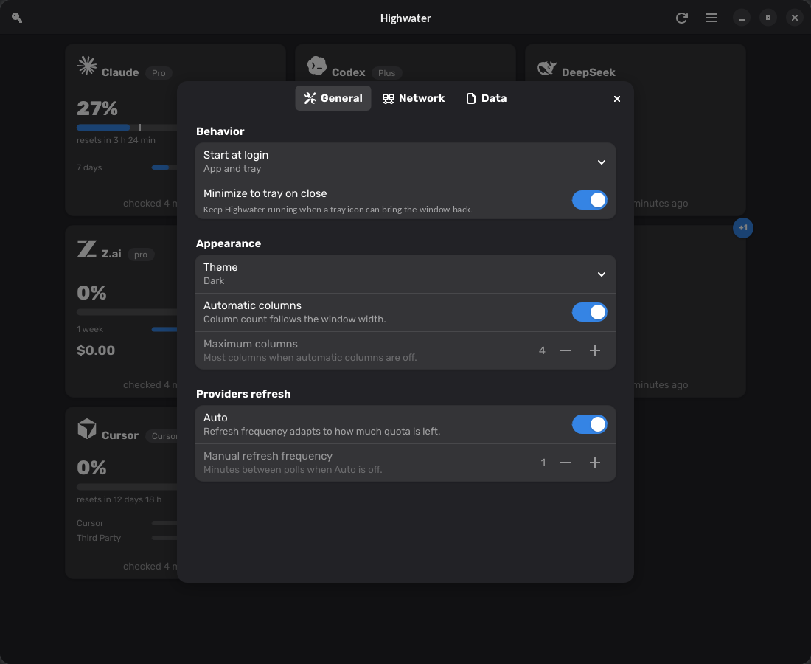

<div align="center">


# Highwater

**See how much of your AI quota is left in one GUI app**

[](https://github.com/kakadon000/highwater/releases/latest)
[](https://github.com/kakadon000/highwater/releases)
[](https://github.com/kakadon000/highwater/stargazers)
[](https://kakadon000.github.io/highwater/)

---



</div>

---

Highwater shows every rate-limit window your AI providers report: how much you have burned,
when it resets, and whether your current pace gets you there. One card per account, side by
side, so you can tell at a glance which provider to start a long run on.

A background service keeps polling while the window is closed, so the tray icon and the
notifications stay current. Native Rust and Slint — no Electron, no embedded browser.

- **Every window.** Five-hour, weekly, monthly — whatever the provider
  exposes, each with its own reset time.
- **Several accounts per provider.** A work and a personal Claude, two Z.ai keys — grouped
  behind an expand toggle, each named whatever you call it, in any script (`Работа`,
  `Team Lead`), shown above the provider's own name on the card.
- **A pace mark on every bar.** Fill to the left of the mark means the quota likely lasts until
  the reset; fill to the right means it does not.
- **Warnings at 70% and 90%,** plus a notification when a window resets. Off by default,
  switched on per window so you only hear about the ones you care about.
- **History and a burn-down chart.** Click a card to see how the current window was spent.
- **Lives in the tray.** Closing the window hides it; readings keep arriving.
- **A desktop widget.** A small translucent card that floats over the desktop, draggable by
  its header: one row per provider — the provider's own mark on its brand colour, the same
  reading and quota bar the cards show — with its own size, opacity and always-on-top
  settings, shown or hidden from the tray, the preferences or the card itself.

---

## Screenshots

| Details | Provider settings |
| --- | --- |
|  |  |

| Providers | Preferences |
| --- | --- |
|  |  |

## Installation

### Windows

Download the setup executable from the
[latest release](https://github.com/kakadon000/highwater/releases/latest), or grab the raw
`.exe` files from the **Highwater-windows-exe** artifact of any
[Windows EXE workflow run](https://github.com/kakadon000/highwater/actions/workflows/exe.yml).
It installs for the current user only and needs no administrator rights. The Inno Setup 7
installer handles manual upgrades and preserves startup preferences and user data. Native
MSVC build and recovery instructions are in
[Windows packaging](data/packaging/windows/README.md).
The installer is not code-signed, so SmartScreen stops the first run — More info → Run anyway.

### Ubuntu/Fedora

Download the `.deb` or `.rpm` from the [latest release](https://github.com/kakadon000/highwater/releases/latest):

### Arch Linux

```bash
yay -S highwater-git
```

### Nix

```bash
nix profile install github:kakadon000/highwater
```

Or run the window without installing it:

```bash
nix run github:kakadon000/highwater
```

## Getting started

Open Highwater. With nothing configured yet it says *Add a provider to start tracking your
quota*.

1. Open provider settings and press **+**.
2. Pick your provider from the searchable list.
3. Sign in, or paste an API key — the detail page says where to find it.

Keys are stored in your desktop keyring, never in a config file. Claude, Codex and
Antigravity can sign in through Highwater, or reuse the login their own CLI already has.

Removing a provider deletes its Highwater-owned credentials and its card but keeps the quota
history. A vendor CLI's own credential file remains owned by that CLI and is never removed.

## From the command line

`highwaterctl` talks to the same daemon the window does, so anything the interface can do is
scriptable — and a panel widget needs no D-Bus code of its own.

```bash
highwaterctl usage                      # every account, for a person
highwaterctl usage --format json        # {"accounts": [...]}, for a program
highwaterctl guard --min-remaining 20 --window w604800 || echo "not this week"
highwaterctl watch                      # one JSON object per change, until you stop it
```

`guard` exits `0` when the quota is there, `1` when it is not, and `69` when there is no
trustworthy reading to judge — a rejected credential never answers "safe".

Secrets are read from stdin, never from the command line:

```bash
printf '%s' "$ZAI_API_KEY" | highwaterctl auth set-key zai
```

Commands that act on one existing account use `default` unless `--account work` says
otherwise. Aggregate commands keep their broader meaning: `usage`, `guard` and `watch`
still include every matching account when no account filter is given.

A newly added Claude, Codex or Antigravity account starts pinned to Highwater OAuth; adding
it never silently adopts the vendor CLI's login:

```bash
highwaterctl provider add codex
highwaterctl auth login codex

# Or explicitly use the Codex CLI login that already exists:
highwaterctl auth select codex --mode cli
```

A Waybar module is two files. In `~/.config/waybar/config.jsonc`:

```jsonc
"custom/highwater": {
    "exec": "highwaterctl watch --format waybar",
    "return-type": "json",
    "on-click": "highwater"
}
```

and in your stylesheet, the classes it sets — `ok`, `warning`, `danger` at the same 70% and
90% the app's own bar changes colour at, plus `stale` when the reading is not fresh:

```css
#custom-highwater.warning { color: @warning_color; }
#custom-highwater.danger  { color: @error_color; }
#custom-highwater.stale   { opacity: 0.5; }
```

`highwaterctl completions zsh > ~/.zfunc/_highwaterctl` installs completions;
`highwaterctl --help` lists the rest — `provider`, `account`, `auth`, `notify`, `config`,
`history`.

## Reporting a wrong reading

If a card shows a number the provider's own dashboard disagrees with, the useful evidence
is the response Highwater actually received. Put this in `~/.config/highwater/config.toml`:

```toml
[debug]
raw_responses = true
```

then `systemctl --user restart highwaterd`. Every provider response is written verbatim,
one JSON object per line, to `~/.local/share/highwater/debug/responses.ndjson`:

```bash
jq 'select(.provider == "opencodego")' ~/.local/share/highwater/debug/responses.ndjson
```

API keys are never written: request headers are left out entirely, URL query strings are
redacted, and the sign-in endpoints are not logged at all. The file still describes your
account's usage, so read it before attaching it to an issue. It rolls over at 16 MB and
keeps one previous file. There is no switch in the interface — turning it off is the same
edit, and a restart.

## Supported providers

**Sign in with your account**

Antigravity · Claude · Codex

**Paste an API key**

ai& · Amp · Chutes · ClawRouter · ClinePass · Codebuff · Crof · Deepgram · DeepInfra · DeepSeek ·
ElevenLabs · Factory · Fireworks · Groq · IBM Bob · Kilo · Kimi · LiteLLM · LLM Proxy · MiniMax ·
Moonshot · NanoGPT · Neuralwatt · OpenAI · OpenCode Go · OpenRouter · Poe · StepFun · sub2api ·
Synthetic · Venice · Warp · xAI · Z.ai · ZenMux

**Local session**

Abacus · Alibaba Coding Plan · Augment · CommandCode · Cursor · Gemini · Grok · LongCat · Manus · MiMo · Mistral · Notion · Ollama · OpenCode · Perplexity · Qoder · Sakana · T3 Chat · ZoomMate

**No credential needed**

Wayfinder

Some providers need one extra setting alongside the key — a region, an account id, or the
base URL of your own deployment. The provider's page asks for it.

**Something else**

If the service you use is not listed, you can teach Highwater to read it without waiting for
a release. A provider plugin is one `.highwater-provider` file — metadata, a sandboxed Lua
transformation and an optional mark — that you import from **Providers → Import a provider
file**, then point at your own endpoint with your own key. The file cannot name a host and
never sees the key. See [`docs/plugin-providers.md`](docs/plugin-providers.md) for the
format, the sandbox and a worked example.

## Requirements

A Wayland or X11 desktop with OpenGL. The packages are built for **Fedora 44+** and
**Ubuntu 26.04 LTS+** and their derivatives; Arch and other rolling releases are fine.
On Windows 10/11 the setup carries everything it needs.

## Building from source

Needs Rust 1.92 or newer, CMake, Clang, and the development packages for fontconfig and
SQLite:

```bash
git clone https://github.com/kakadon000/highwater.git
```

```bash
cargo build --workspace
```

```bash
cargo run -p highwater
```

`highwaterd` does the polling and `highwater` is the window. The window never talks to a
provider itself — it only shows what the daemon publishes on D-Bus, which also makes the
daemon usable from `busctl` or a Waybar module. See [`CONTEXT.md`](CONTEXT.md) for the
architecture and the design record.

## License

MIT — see [`LICENSE`](LICENSE).

The provider marks under `data/icons` are their owners' trademarks and are not covered by
this licence; see [`docs/TRADEMARKS.md`](docs/TRADEMARKS.md), which also explains how to
build without them.

